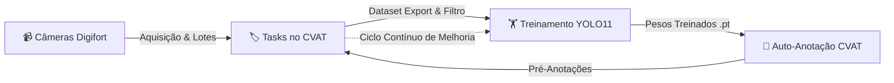

# CVAT AI Toolkit Web

Plataforma Web unificada em FastAPI para **Aquisição de Imagens Digifort**, **Treinamento de Modelos YOLO (YOLO11)**, **Auto-Anotação assistida por IA no CVAT** e **Fila Sequencial de Execução (FIFO)** com telemetria de GPU/CPU em tempo real.

---

## 🚀 Módulos da Aplicação



### 1. 📹 Aquisição de Imagens (Digifort & Câmeras IP)
- **Wizard Interativo:** Teste de snapshot ao vivo e histórico diretamente pelo navegador.
- **Workers em Background:** Cada câmera roda seu próprio worker com checkpoint seguro em `.history.json`, retomando exatamente do ponto onde parou mesmo após reinicialização.
- **Telemetria PTZ:** Suporte a posicionamento Pan, Tilt, Zoom e filtragem por presets autorizados.
- **Criação Automática de Tasks:** Envio automático de lotes para projetos do CVAT com prefixos customizáveis.

### 2. 🏋️ Treinamento de Modelos YOLO
- **Suporte YOLO11:** Detecção de Objetos (`Bounding Boxes`) e Segmentação de Instâncias (`Polígonos`).
- **Composição de Dataset:** Escolha de tarefas concluídas, filtragem inteligente de frames deletados no CVAT e inclusão opcional de fotos de fundo negativo.
- **Hiperparâmetros:** Controle de épocas (padrão 1000 épocas), batch size, resolução (`imgsz`), amostragem estratificada e seleção de dispositivo (GPU CUDA / CPU).
- **Catálogo de Modelos Treinados:** Visualização detalhada de curvas de treino, métricas de loss/mAP50, matriz de confusão e download dos pesos `best.pt`.

### 3. 🎯 Auto-Anotação / Inferência
- **Inferência Assistida por IA:** Aplica modelos treinados sobre tarefas novas ou pendentes no CVAT.
- **Limitação de Instâncias por Imagem:** Opção de limitar quantidade máxima de detecções por frame (priorizando maior confiança).
- **Estágio de Validação:** Marca automaticamente tarefas processadas como `validation` (prontas para revisão humana rápida).

### 4. 📋 Fila Sequencial de Execução (Jobs FIFO)
- **Garantia de Estabilidade:** Fila única que impede execuções concorrentes de GPU/VRAM, prevenindo erros de memória (`Out Of Memory`).
- **Acompanhamento em Tempo Real:** Logs e progresso percentual via Server-Sent Events (SSE).
- **Cancelamento Seguro:** Permite cancelar tarefas em execução ou na fila a qualquer momento.

---

## 💻 Como Iniciar o Sistema

### Pré-requisitos
- Python 3.11+ e gerenciador de pacotes `uv`.
- Acesso à rede com o servidor Digifort e a instância do CVAT.

### Configuração (.env)
Copie o modelo de configuração na pasta da aplicação web:

```bash
cd cvat_toolkit_web
cp .env.example .env
```

Preencha as variáveis de conexão com o CVAT (`CVAT_HOST`, `CVAT_USERNAME`, `CVAT_PASSWORD`).

### Executando o Servidor Web

```bash
cd cvat_toolkit_web
uv run python run.py
```

O sistema ficará disponível em:
- **Porta padrão:** [http://localhost:3012](http://localhost:3012) (ou pelo IP da máquina: `http://<SEU_IP>:3012`)
- **Porta secundária:** [http://localhost:3013](http://localhost:3013)

---

## 🧪 Testes Automatizados

A suíte completa de testes da aplicação web pode ser executada com:

```bash
cd cvat_toolkit_web
uv run python -m unittest discover -s tests -v
```
