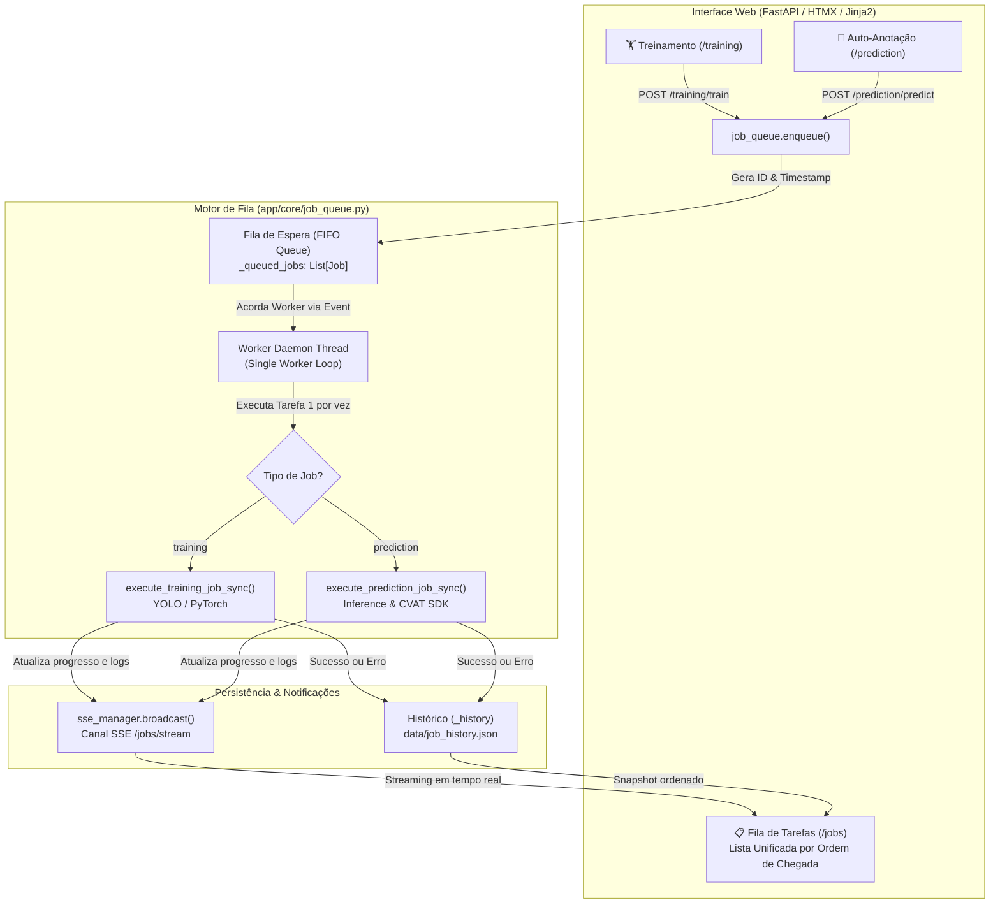
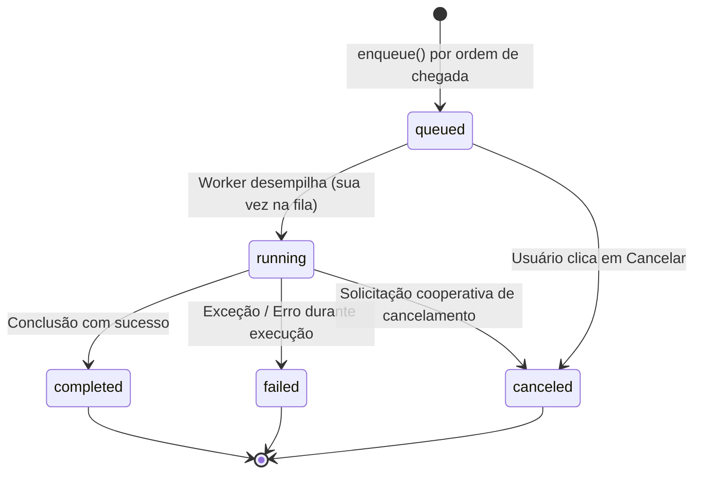

# Arquitetura da Fila de Tarefas Assíncronas (Celery vs. Worker Nativo) ⚡📋

Este documento descreve detalhadamente a arquitetura de processamento assíncrono de tarefas (*background jobs*) implementada no **CVAT AI Toolkit Web**, esclarecendo a equivalência ao papel tradicionalmente associado ao **Celery**, as decisões de engenharia adotadas e como a visualização em lista unificada por **ordem de chegada** funciona na interface.

---

## 1. Visão Geral: O "Celery" das Tarefas no Toolkit Web

No ecossistema Python, tarefas de longa duração em segundo plano são frequentemente chamadas de *"tarefas do Celery"*. No entanto, tarefas de Visão Computacional (Deep Learning, YOLO, PyTorch, PyAV e anotações massivas via SDK do CVAT) possuem características particulares:
1. **Consumo Extremo de Recursos (VRAM de GPU e CPU)**: Duas tarefas de treinamento disparadas em paralelo numa mesma placa de vídeo (como uma RTX 3060/4090) resultam em erro fatal de memória (`CUDA: Out Of Memory`) ou degradação mútua de performance.
2. **Necessidade de Execução Sequencial Estrita (FIFO)**: O processamento precisa respeitar uma fila única — uma tarefa por vez, na exata **ordem de chegada**.
3. **Complexidade Operacional Mínima**: Subir serviços externos de mensageria como Redis, RabbitMQ ou brokers pesados adiciona fricção desnecessária para quem deseja apenas rodar `uv run python run.py`.

Por essas razões, o toolkit adota um **Gerenciador de Fila Assíncrono Nativo (`JobQueueManager`)** com **Single Worker Daemon Thread**, cumprindo rigorosamente as mesmas responsabilidades de um cluster Celery, porém de forma 100% autocontida, resiliente, segura e integrada com *Server-Sent Events* (SSE).

---

## 2. Diagrama Arquitetural de Tarefas

---

## 3. Comparativo: Gerenciador Nativo vs. Celery Tradicional

| Aspecto | Gerenciador Nativo Atual (`JobQueueManager`) | Celery + Redis / RabbitMQ |
|---|---|---|
| **Dependências Externas** | **Zero**. Apenas biblioteca padrão Python (`threading`, `queue`, `dataclasses`). | Requer Broker externo (Redis, RabbitMQ) rodando em porta separada. |
| **Proteção de VRAM / GPU** | **Nativa**. Execução sequencial estrita (1 job ativo por vez), eliminando riscos de CUDA OOM. | Exige configuração cuidadosa de concorrência (`--concurrency=1`, `-P solo`). |
| **Ordem de Chegada (FIFO)** | **Garantida**. Tarefas entram na fila e são processadas na exata ordem em que chegaram. | Requer configuração de fila FIFO simples no broker. |
| **Feedback em Tempo Real** | Integrado diretamente com `sse_manager` (SSE), enviando logs e percentuais a cada época/frame. | Requer backend de resultados (Result Backend) ou websocket intermediário. |
| **Persistência de Histórico** | Arquivo JSON atômico local (`data/job_history.json`) com limite configurável (`MAX_JOB_HISTORY`). | Armazenado em Redis, Banco SQL ou backend do Celery. |
| **Recuperação de Falhas** | Na inicialização, detecta se o servidor foi reiniciado e marca tarefas interrompidas sem corromper o estado. | Requer configuração de visibilidade de ACK e timeout de tarefas mortas. |

> [!NOTE]
> Caso futuramente seja necessário distribuir o processamento entre **múltiplas máquinas com GPUs separadas**, a interface de `JobQueueManager` foi projetada de modo a permitir a substituição do backend de despacho para tarefas do Celery sem alterar os módulos de Treinamento ou Auto-Anotação.

---

## 4. Ciclo de Vida e Estados da Tarefa

Todas as tarefas cadastradas no sistema passam por estados bem definidos:

### Rótulos Amigáveis da Interface:
- ⏳ **Em espera**:
  - `status == "queued"`: A tarefa está na fila aguardando sua vez de acordo com a ordem de chegada.
  - `status == "running"`: A tarefa foi alocada pelo worker e está em execução ativa no momento (ex.: `Em espera (Em execução: 45%)`).
- ✅ **Finalizado com sucesso**:
  - `status == "completed"`: Treinamento ou auto-anotação concluída sem falhas. Métricas, pesos do modelo (`best.pt`) ou anotações enviadas ao CVAT ficam registrados.
- ❌ **Finalizado com erro**:
  - `status == "failed"`: Ocorreu uma exceção (ex.: erro de conexão CVAT, falha de anotação, CUDA OOM). O motivo do erro é capturado e exibido com destaque.
- ⚠️ **Cancelado**:
  - `status == "canceled"`: O usuário optou por interromper a tarefa antes do início ou durante o processamento.

---

## 5. Visualização Simplificada por Ordem de Chegada

A aba **Fila de Tarefas** (`/jobs`) foi consolidada em uma **única lista clara e direta**, eliminando telas fragmentadas:

### 1. Critério de Exibição (Mais Novo para o Mais Antigo)
- A lista organiza as tarefas de forma decrescente por estágio e data de criação:
  1. ⏳ **Em espera**: Tarefas aguardando na fila (as recém-adicionadas no topo).
  2. ⚡ **Executando**: Tarefa atualmente alocada na GPU/CPU.
  3. ✓ **Finalizado com sucesso** e ✕ **Finalizado com erro**: Tarefas concluídas, das mais recentes para as mais antigas.
- Cada linha exibe seu identificador ordinal (`#1`, `#2`...), status amigável e descrição rica.

### 2. Atualização em Tempo Real (SSE)
- A tabela é **100% reativa em tempo real**. Ao adicionar um novo treino ou predição em outra aba, a nova tarefa surge no topo da fila imediatamente, sem necessidade de refresh manual.
- Transições de estado (`Em espera` ➔ `Executando` ➔ `Finalizado`) e percentuais de progresso são atualizados dinamicamente via stream SSE (`/jobs/stream`).

### 3. Paginação Integrada (Sem Filtros)
A visualização é direta e sem barras de filtros poluindo a tela, acompanhada de paginação limpa:
- Navegação entre páginas (`« Anterior`, `[1]`, `[2]...`, `Próximo »`).
- Indicador transparente de volume: `Mostrando 1–10 de N tarefas (mais novo para mais antigo)`.
- Seletor de tamanho de página (`5`, `10`, `25`, `50` tarefas por página).

### 4. Ações e Logs em Modal
- Botão **Cancelar**: Permite cancelar tarefas que estejam aguardando ou em execução.
- Botão **Logs**: Abre um modal limpo com a visualização do terminal e os últimos logs gerados daquela tarefa, sem sobrecarregar visualmente a tela principal.

---

## 6. Endpoints da API de Tarefas

Abaixo estão as rotas disponíveis no módulo de tarefas (`app/modules/jobs/router.py`):

| Método | Endpoint | Descrição |
|---|---|---|
| `GET` | `/jobs` | Renderiza a página HTML da Fila de Tarefas simplificada. |
| `GET` | `/jobs/snapshot` | Retorna o snapshot completo em JSON com a lista unificada de `tasks` ordenadas por chegada, contadores e tarefa ativa. |
| `GET` | `/jobs/stream` | Stream SSE (*Server-Sent Events*) transmitindo atualizações em tempo real (`queue_update`, `progress`, `log`). |
| `POST` | `/jobs/{job_id}/cancel` | Solicita o cancelamento de uma tarefa específica. |
| `DELETE` | `/jobs/history` | Limpa o histórico de tarefas já finalizadas. |

---

## 7. Estrutura do Código

Os arquivos fundamentais para a fila de tarefas estão organizados em:
- [app/core/job_queue.py](file:///home/igor/Projetos/cvat-digifort-image-labeling-toolkit-interface-web/cvat_toolkit_web/app/core/job_queue.py): Motor assíncrono, classe `Job`, gerenciamento thread-safe, persistência em disco e ordenação por chegada.
- [app/core/events.py](file:///home/igor/Projetos/cvat-digifort-image-labeling-toolkit-interface-web/cvat_toolkit_web/app/core/events.py): Gerenciador pub/sub de Server-Sent Events (SSE).
- [app/modules/jobs/router.py](file:///home/igor/Projetos/cvat-digifort-image-labeling-toolkit-interface-web/cvat_toolkit_web/app/modules/jobs/router.py): Rotas FastAPI de visualização, snapshot JSON e streaming.
- [app/modules/jobs/templates/index.html](file:///home/igor/Projetos/cvat-digifort-image-labeling-toolkit-interface-web/cvat_toolkit_web/app/modules/jobs/templates/index.html): Interface web simplificada, tabela unificada com ordem de chegada e modal de logs.
