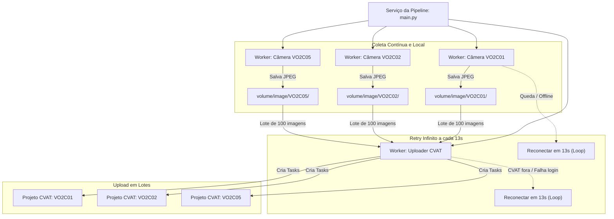

# Serviço de Pipeline: Coleta de Câmeras e Envio Contínuo ao CVAT

Este diretório contém o **serviço unificado de pipeline**, responsável por integrar em um processo único a coleta contínua de fotos de câmeras IP / Digifort e o envio automatizado de lotes para projetos no CVAT.

---

## 1. Visão Geral

O serviço funciona como um **daemon em segundo plano**:
- Não exige banco de dados, Redis ou filas externas.
- Executa workers assíncronos independentes para cada câmera e para o uploader do CVAT.
- Possui **tolerância total a falhas de rede**: quedas de câmeras ou indisponibilidade do CVAT não interrompem o serviço.



---

## 2. Comportamento como Serviço

1. **Retry Infinito (13 segundos):**
   - Se uma câmera cair ou falhar o snapshot, o worker daquela câmera tenta reconectar a cada **13 segundos**, infinitamente. As outras câmeras continuam capturando normalmente.
   - Se o servidor CVAT estiver inacessível, fora do ar ou com login incorreto, o uploader tenta reconectar a cada **13 segundos**, infinitamente. O download de fotos das câmeras continua ocorrendo sem travas.
2. **Backlog e Retomada Automática:**
   - Durante qualquer período em que o CVAT estiver fora, as imagens se acumulam com segurança no disco local (`volume/image/<CAMERA>`), com checkpoints gravados no arquivo `.history.json`.
   - Assim que o CVAT volta a responder, o serviço detecta todas as fotos que ficaram no backlog, organiza em lotes de 100 e faz o upload sequencial em ordem cronológica.
3. **Criação e Separação por Projetos:**
   - Cria automaticamente um projeto por câmera na organização configurada (ex: `VO2C01`, `VO2C02`, `VO2C05` na organização `VOD`).
   - Cada projeto recebe exclusivamente as fotos da respectiva câmera.

---

## 3. Configuração

O serviço utiliza o arquivo `pipeline.env` na raiz do projeto (ou `pipeline.env.example` como modelo):

```dotenv
# pipeline.env
PIPELINE='{
  "cameras": {
    "env_file": "digifort-scripts/.env"
  },
  "cvat": {
    "enabled": true,
    "env_file": "cvat_scripts/.env"
  }
}'

RESTART_SECONDS=13
```

- **`cameras.env_file`:** aponta para o arquivo com a lista `CAMERAS`, intervalos, resoluções e diretório de saída.
- **`cvat.env_file`:** aponta para o arquivo com URL, credenciais, organização, lista `FOLDERS` e tamanho dos lotes (`images_per_task: 100`).

---

## 4. Execução Manual / Interativa

A partir da raiz do repositório:

```powershell
# 1. Conferir se arquivos, sintaxe e JSONs estão válidos:
uv run python pipeline.py --check

# 2. Iniciar a execução contínua:
uv run python pipeline.py

# 3. Ou executar somente a coleta (ignora CVAT):
uv run python pipeline.py --collect-only

# 4. Ou simular o upload sem criar tasks reais no CVAT:
uv run python pipeline.py --dry-run
```

Para encerrar a execução interativa: pressione `Ctrl + C`. O serviço cancela as conexões e encerra sem corromper arquivos.

---

## 5. Como Rodar como Serviço no Windows (Produção)

Para ambientes de produção onde o script deve continuar rodando 24/7 mesmo se o usuário fizer logoff ou a máquina reiniciar, escolha uma das opções abaixo:

### Opção A: Windows Service via NSSM (Recomendado para Servidores)

O [NSSM](https://nssm.cc/) transforma qualquer script em um Serviço oficial do Windows gerenciado pelo `services.msc`.

1. Baixe o executável `nssm.exe` (ou instale via `winget install nssm` / `choco install nssm`).
2. Abra o PowerShell como Administrador e instale o serviço:

```powershell
$AppPath = (Get-Command uv).Source
$WorkDir = "C:\Users\ax12813\Desktop\Projetos\digifort-scripts-get-image"
$Args    = "run python pipeline.py"

nssm install DigifortCvatPipeline $AppPath $Args
nssm set DigifortCvatPipeline AppDirectory $WorkDir
nssm set DigifortCvatPipeline Description "Servico continuo de coleta Digifort e envio CVAT"
nssm set DigifortCvatPipeline Start SERVICE_AUTO_START
nssm set DigifortCvatPipeline AppStdout "$WorkDir\volume\pipeline_stdout.log"
nssm set DigifortCvatPipeline AppStderr "$WorkDir\volume\pipeline_stderr.log"

# Iniciar o serviço:
nssm start DigifortCvatPipeline
```

3. Para gerenciar o serviço:
   - Iniciar: `Start-Service DigifortCvatPipeline`
   - Parar: `Stop-Service DigifortCvatPipeline`
   - Status: `Get-Service DigifortCvatPipeline`

---

### Opção B: Agendador de Tarefas do Windows (Task Scheduler)

Sem instalar ferramentas adicionais, você pode criar uma tarefa agendada:

1. Abra o **Agendador de Tarefas** (`taskschd.msc`).
2. Clique em **Criar Tarefa**:
   - **Nome:** `Digifort-CVAT-Pipeline`
   - Marque: `Executar se o usuário estiver conectado ou não`
   - Marque: `Executar com privilégios mais altos`
3. Na aba **Disparadores (Triggers)**:
   - Adicionar novo disparador: `Ao inicializar` (At startup).
4. Na aba **Ações (Actions)**:
   - Ação: `Iniciar um programa`
   - Programa: `C:\Users\ax12813\.cargo\bin\uv.exe` (caminho do executável do uv)
   - Argumentos: `run python pipeline.py`
   - Iniciar em (pasta): `C:\Users\ax12813\Desktop\Projetos\digifort-scripts-get-image`
5. Na aba **Configurações**:
   - Marque: `Se a tarefa falhar, reiniciar a cada 1 minuto`.
   - Desmarque: `Interromper a tarefa se ela for executada por mais de X dias`.

---

### Opção C: Background Job no PowerShell

Para rodar em segundo plano durante a sessão atual sem manter uma janela de terminal aberta:

```powershell
Start-Process -FilePath "uv" `
              -ArgumentList "run python pipeline.py" `
              -WorkingDirectory "C:\Users\ax12813\Desktop\Projetos\digifort-scripts-get-image" `
              -WindowStyle Hidden
```

---

## 6. Como Rodar como Serviço no Linux (systemd)

Se o projeto for implantado em servidor Linux, crie a unit file em `/etc/systemd/system/cvat-pipeline.service`:

```ini
[Unit]
Description=Digifort to CVAT Pipeline Service
After=network.target

[Service]
Type=simple
User=seu_usuario
WorkingDirectory=/caminho/para/digifort-scripts-get-image
ExecStart=/caminho/para/uv run python pipeline.py
Restart=always
RestartSec=13
Environment=PYTHONUNBUFFERED=1

[Install]
WantedBy=multi-user.target
```

Ativação:
```bash
sudo systemctl daemon-reload
sudo systemctl enable cvat-pipeline
sudo systemctl start cvat-pipeline
sudo systemctl status cvat-pipeline
```

---

## 7. Monitoramento e Logs

- Os logs registram o salvamento de imagens por câmera, status de lotes, criações de tasks e tentativas de reconexão.
- Se o CVAT falhar temporariamente, os avisos indicarão:
  `[CVAT] Falha na comunicacao com CVAT (...); tentando reconectar em 13s...`
- O progresso de cada câmera fica persistido em `volume/image/<CAMERA>/.history.json`.
